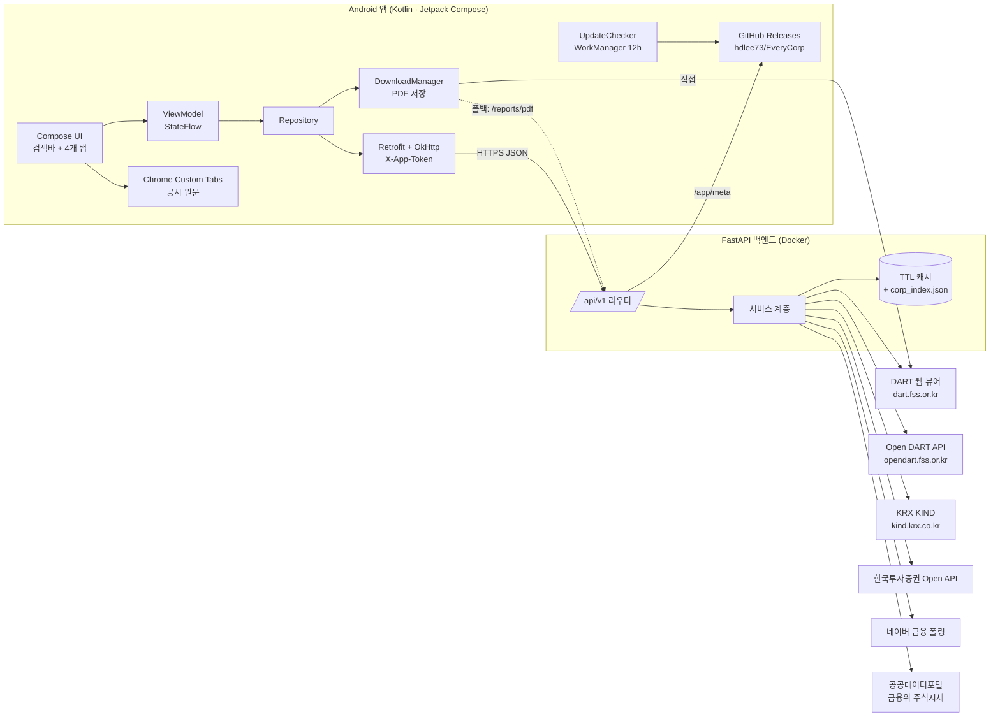

# EveryCorp 시스템 아키텍처 (Step 1)

> 앱 이름: **EveryCorp (에브리코프 기업정보)** · 만든이: **이현덕 (hdlee73@gmail.com)** · 버전 체계: `MAJOR.MINOR.PATCH` (첫 출시 1.0.0)

국내 기업(상장법인 + 비상장 외감법인)의 기업개황, 감사·검토보고서 PDF, DART·KIND 통합 공시, 실시간 주가를 보여주는 안드로이드 앱과 이를 중계하는 경량 FastAPI 서버로 구성한다.

---

## 1. 전체 구성



### 왜 서버를 두는가
| 이유 | 설명 |
|---|---|
| **키 보호** | DART·KIS·공공데이터 키를 APK에 넣으면 디컴파일로 유출된다. 키는 서버 환경변수(GitHub Secrets에서 주입)에만 둔다. |
| **corp_code 매핑** | DART `corpCode.xml`은 약 10만 건 zip(수십 MB). 서버가 하루 1번 받아 인덱스로 두고, 앱은 검색 결과만 받는다. |
| **HTML 파싱** | DART 뷰어 `dcm_no`, KIND 공시 목록은 HTML 파싱이 필요하다. 사이트 구조가 바뀌면 서버만 고치면 되고 앱 업데이트가 필요 없다. |
| **호출량 절감** | DART 일 20,000건 한도. 캐시로 같은 기업 반복 조회 시 외부 호출을 0회로 만든다. |

---

## 2. 백엔드 구조 (`backend/`)

```
backend/app/
├── main.py                 # 앱 생성, 시작 시 corp_index 적재 + 24h 갱신 루프
├── config.py               # 환경변수 설정(키는 여기서만 읽음), 앱 이름·만든이 상수
├── cache.py                # 비동기 TTL 캐시(동시 요청 합치기)
├── http.py                 # 공용 httpx.AsyncClient
├── errors.py               # {"error":{"code","message"}} 형식
├── routers/api.py          # REST 엔드포인트(/api/v1)
├── services/
│   ├── dart_client.py      # Open DART 호출, 페이지네이션, status 처리
│   ├── corp_index.py       # corp_code 매핑·검색(초성/종목코드 지원)
│   ├── company_service.py  # 탭1: 기업개황·최대주주·재무
│   ├── reports_service.py  # 탭2: 감사/검토보고서 rcp_no·dcm_no 수집
│   ├── kind_client.py      # 탭3: KIND 공시 수집
│   ├── disclosures_service.py # 탭3: DART+KIND 통합
│   ├── price_service.py    # 탭4: KIS/네이버 현재가, 공공데이터/네이버 일봉
│   └── app_meta.py         # 앱 정보·업데이트 정보
├── parsers/                # 네트워크 없는 순수 파싱 함수(단위 테스트 대상)
│   ├── dart_overview.py    # 정기보고서 해석, 최대주주 요약, 영업수익 분기
│   ├── dart_viewer.py      # 뷰어 HTML → rcp_no/dcm_no, PDF URL
│   ├── kind.py             # KIND 결과 표 파싱
│   └── price.py            # 시세 응답 파싱, 52주 최고/최저
└── utils/                  # 금액 포맷(조·억·백만원), 회사명 정규화·초성
```

### 2.1 탭별 데이터 흐름

**탭 1 기업개황** — `GET /corps/{corp_code}/overview`
1. `company.json` → 대표이사(`ceo_nm`), 시장구분(`corp_cls`), 결산월(`acc_mt`), 업종(`induty_code`)
2. `list.json?pblntf_ty=A`(최근 27개월) → 사업/반기/분기보고서 이름 `반기보고서 (2026.06)`을 해석해 **최직근 정기보고서**와 `reprt_code`(11011/11012/11013/11014)를 정한다. 분기는 결산월로 1분기·3분기를 구분.
3. `hyslrSttus.json` → 보통주 기준 최대주주(`relate`가 본인/최대주주), 특수관계인 수(합계·본인 제외 고유 이름 수), 합산 지분율(`계` 행, 없으면 합) → `"최대주주 OOO 외 특수관계인 N명 (합산 지분율 XX.X%)"`. 최신 보고서에 없으면 직전 보고서로 내려간다.
4. `fnlttSinglAcntAll.json`(최직근 **사업보고서**) → `fs_div=CFS`(연결) 먼저, 없으면 `OFS`(별도). XBRL `account_id` 우선, 없으면 `account_nm`으로 계정을 찾는다.
5. **영업수익 분기**: 매출 계정의 `account_nm`에 `영업수익`이 들어 있으면 라벨을 `영업수익`으로 바꾼다(금융지주·증권·보험 등). 매출 계정을 못 찾았는데 업종이 금융·보험(KSIC 64~66)이어도 `영업수익`.
6. 외감법인 등 정기보고서 비제출 법인은 `available:false`와 안내 문구를 준다(앱은 감사보고서 탭으로 안내).

**탭 2 감사·검토보고서** — `GET /corps/{corp_code}/audit-reports`
1. `list.json?pblntf_ty=F`(외부감사관련, 최근 3년) → 단독 `감사보고서`/`연결감사보고서` 공시. 뷰어 `dsaf001/main.do?rcpNo=` HTML에서 본문 `dcmNo`를 뽑는다(`openPdfDownload('rcp','dcm')` 또는 `node1['dcmNo']`).
2. `list.json?pblntf_ty=A`(최근 3년) → 정기보고서 뷰어의 `<select id="att">`(첨부선택) 옵션 `/dsaf001/main.do?rcpNo=..&dcmNo=..` 중 이름에 `감사보고서`/`검토보고서`가 있는 첨부(감사전재무제표·내부회계 제외).
3. 같은 (기간, 감사/검토, 연결여부)는 하나로 합치고 단독 공시를 우선, 최신순 정렬.
4. PDF URL: `https://dart.fss.or.kr/pdf/download/pdf.do?rcp_no={rcp_no}&dcm_no={dcm_no}` → 앱 `DownloadManager`로 저장 후 PDF 뷰어로 연다. DART가 세션 쿠키 없이 PDF를 주지 않는 경우를 대비해 서버 중계 `/reports/pdf`(뷰어 쿠키 획득 → PDF 스트리밍, `%PDF` 시그니처 확인)를 폴백으로 둔다.
5. 뷰어 HTML은 7일 캐시(접수된 문서는 바뀌지 않음), 동시 요청 4개로 제한.

**탭 3 공시목록** — `GET /corps/{corp_code}/disclosures?years=1..10`
- DART `list.json`(corp_code 지정 시 기간 제한 없음, 100건씩 전체 페이지) + KIND `details.do`(POST, `searchDetailsSub`, 100건씩)을 합쳐 **공시일자 → 시각 → 접수번호** 내림차순 정렬. 서버에서 페이지 나눔(`page`,`size`).
- KIND는 회사명 검색이 부분일치라 결과 행의 회사코드(`companysummary_open('00593')` = 종목코드 앞 5자리)로 다시 거른다. 비상장사는 KIND를 건너뛴다.
- `dedupe=true`면 같은 날짜·같은 제목(괄호·접두어 무시)의 KIND 항목을 숨긴다(기본 false: 요구사항대로 둘 다 표시).
- 원문 URL: DART 모바일 뷰어 `m.dart.fss.or.kr/html_mdart/MD1007.html?rcpNo=`, KIND `kind.krx.co.kr/common/disclsviewer.do?method=search&acptno=`.

**탭 4 주가현황** — `GET /corps/{corp_code}/stock/quote`, `/stock/chart`
- 현재가: KIS `inquire-price`(TR `FHKST01010100`, 토큰 24h 재사용) → 키 없음/실패 시 네이버 `polling.finance.naver.com` 폴링. 서버 5초 캐시, 앱은 탭이 보일 때만 5초 간격 폴링.
- 1년 일봉: 공공데이터포털 `GetStockSecuritiesInfoService/getStockPriceInfo`(T+1 영업일 지연) → 실패 시 네이버 `siseJson`. 52주 최고/최저는 일별 **고가/저가** 기준으로 계산(일자 포함).
- 비상장: `404 NOT_LISTED` → 앱은 탭 비활성 + 안내.

### 2.2 캐시 정책
| 데이터 | TTL | 근거 |
|---|---|---|
| corp_code 인덱스 | 24시간(디스크 보관) | DART 고유번호는 신규 등록 때만 바뀜 |
| 기업개황 company.json | 24시간 | 대표이사 등 변경 드묾 |
| 정기보고서 목록·최대주주·재무 | 6시간 | 공시 시점에만 바뀜 |
| 감사/검토보고서 목록 | 6시간 / 뷰어 HTML 7일 | 접수 문서는 불변 |
| 공시목록 | 30분 | 장중 신규 공시 반영 |
| 현재가 | 5초 | 폴링 간격과 맞춤 |
| 일봉 | 1시간 | 일 단위 데이터 |
| GitHub 최신 릴리스 | 30분 | API 비인증 시간당 60회 한도 |

---

## 3. 보안 · 키 관리 · 배포 (사용자 기본 요구사항 반영)

### 3.1 GitHub Secrets 목록
| Secret | 용도 | 어디에 쓰나 |
|---|---|---|
| `DART_API_KEY` | Open DART 인증키 | 서버 |
| `DATA_GO_KR_KEY` | 공공데이터포털 서비스키(디코딩) | 서버 |
| `KIS_APP_KEY`, `KIS_APP_SECRET` | 한국투자증권 Open API | 서버 |
| `APP_TOKEN` | 앱↔서버 간단 인증 헤더 `X-App-Token` | 서버 + 앱 빌드 |
| `ANDROID_KEYSTORE_BASE64` | **비공개 릴리스 서명키**(base64) | 앱 빌드 |
| `ANDROID_KEYSTORE_PASSWORD`, `ANDROID_KEY_ALIAS`, `ANDROID_KEY_PASSWORD` | 서명키 정보 | 앱 빌드 |
| (서버 배포용) 호스팅 자격증명 | 예: Cloud Run 서비스계정 | 배포 워크플로 |

- 레포에는 `.env.example`만 두고 실제 값은 커밋하지 않는다(`.gitignore`에 `.env`, `*.jks`, `*.keystore`).
- 서버 URL은 비밀이 아니므로 GitHub **Variables**(`API_BASE_URL`)로 둔다.

### 3.2 "공개 레포여도 남이 업데이트를 배포할 수 없게"
FSS Insights는 공개 시험 키(레포에 커밋된 keystore)로 서명하고 있어 누구나 같은 서명의 APK를 만들 수 있다. EveryCorp는 다음과 같이 막는다.
1. **서명키는 Secrets에만**: 릴리스 APK는 `ANDROID_KEYSTORE_BASE64`로만 서명. 키가 없는 사람이 만든 APK는 서명이 달라 안드로이드가 기존 앱 위 설치(업데이트)를 거부한다.
2. **포크·PR에는 Secrets가 전달되지 않음**: GitHub는 포크에서 온 PR 워크플로에 Secrets를 주지 않는다. 릴리스 작업은 `main` push(쓰기 권한자만 가능)일 때만 실행.
3. **업데이트 출처 고정**: 앱은 `api.github.com/repos/hdlee73/EveryCorp/releases/latest`만 본다. 릴리스는 레포 쓰기 권한자만 만들 수 있다.
4. **설치 전 이중 검증**: 내려받은 APK의 SHA-256을 릴리스의 `.sha256`과 비교하고, `PackageManager.getPackageArchiveInfo(..., GET_SIGNING_CERTIFICATES)`로 서명 인증서가 설치된 앱과 같은지 확인한 뒤에만 설치 화면을 연다.
5. **브랜치 보호(권장)**: `main`에 PR 필수·직접 push 금지 설정.

### 3.3 앱 정보 · 업데이트
- 앱 정보 화면: 앱 이름 `EveryCorp`, 버전 `BuildConfig.VERSION_NAME`, 만든이 `이현덕 (hdlee73@gmail.com)`, 업데이트 내용(릴리스 노트), 데이터 출처·면책 안내.
- 자동 업데이트(FSS Insights 방식 계승): 앱 시작 시 + WorkManager 12시간 주기로 확인 → 새 버전 알림 → 앱 안에서 APK 내려받기·검증·설치 화면. 서버 `/app/meta`의 `force_update`가 true면 닫을 수 없는 업데이트 팝업. 업데이트 후 첫 실행 시 "새로운 기능" 팝업.
- `RELEASE_NOTES.md`의 `# EveryCorp vX.Y.Z 변경 내용` 구역이 GitHub 릴리스 본문이 되고 앱이 그 구역만 보여준다.

### 3.4 서버 호스팅(제안 — 확인 필요)
**권장: Google Cloud Run (서울 리전 asia-northeast3)**. 이유: Docker 그대로 배포, 요청 없을 때 0대로 줄어 무료 범위 안에서 운영 가능, **국내 IP**라 KIND·네이버 등 국내 사이트 접속 차단 위험이 낮음. GitHub Actions에서 Secrets를 Cloud Run 환경변수로 주입한다. 대안은 Fly.io(도쿄)·Render(싱가포르, 무료 플랜은 15분 후 잠듦).
단, 인스턴스가 0대로 줄면 메모리 캐시가 비므로 첫 요청이 느리다(corp_index는 디스크 사본 + 이미지 빌드 시 포함으로 보완 예정).

---

## 4. 안드로이드 구조 (Step 3·4 미리보기)

```
app/src/main/java/io/github/hdlee73/everycorp/
├── MainActivity.kt                 # enableEdgeToEdge, 테마
├── data/
│   ├── api/EveryCorpApi.kt         # Retrofit 인터페이스
│   ├── api/dto/*.kt                # 아래 API 명세의 DTO(kotlinx.serialization)
│   ├── repo/CorpRepository.kt      # Flow<Result<T>>
│   ├── pdf/PdfDownloader.kt        # DownloadManager + 완료 브로드캐스트 → PDF 열기
│   ├── update/UpdateChecker.kt     # GitHub Releases + /app/meta
│   └── prefs/FavoritesStore.kt     # 관심기업·최근검색(DataStore)
├── ui/
│   ├── theme/Theme.kt              # FSS Insights 색·글꼴·모서리 계승
│   ├── search/SearchBar.kt         # 자동완성 + [상장]/[외감] 뱃지
│   ├── company/CompanyScreen.kt    # 4개 탭(HorizontalPager + TabRow)
│   ├── tabs/OverviewTab.kt · ReportsTab.kt · DisclosuresTab.kt · StockTab.kt
│   └── info/AppInfoScreen.kt       # 앱 정보·업데이트
└── nav/AppNavHost.kt               # Navigation Compose
```

- **뒤로가기**: Navigation Compose 백스택 + `BackHandler`로 "검색 결과 → 기업 화면 → 탭 이동 기록" 순서로 한 단계씩 돌아간다. 탭 이동도 기록해 뒤로가기 시 직전 탭으로 이동하고, 최상위(검색 홈)에서만 앱이 종료된다(예측형 뒤로가기 제스처 `android:enableOnBackInvokedCallback="true"` 지원).
- **디자인(FSS_insights 준용)**: 연한 하늘색 바탕(`#F2F7FC`) · 흰 카드 · 둥근 모서리(14~20dp) · 강조 파랑(`#2A7DE1`) · 보조 주황(`#F08A4B`), 화면별 그라데이션 머리말(HeroPalette: 기업개황 Sky, 감사보고서 Indigo, 공시 Teal, 주가 Coral), 다크 테마 동일 체계. 등락 색상은 국내 관례대로 상승 빨강 ▲ / 하락 파랑 ▼.
- 차트: **Vico**(Compose 네이티브) 라인 차트 + 52주 최고/최저 표시.

---

## 5. 추가 추천 기능
| 기능 | 내용 | 단계 |
|---|---|---|
| 관심기업 | 별표로 저장, 홈에 목록 | Step 4 |
| 최근 검색 | 검색바 아래 최근 10개 | Step 4 |
| 재무 3개년 추이 | `overview`에 이미 전기·전전기 금액 포함 → 미니 막대그래프 | Step 4 |
| 공시 제목 검색 | `disclosures?q=` 지원(구현됨) | Step 4 |
| 신규 공시 알림 | 관심기업에 새 공시 시 알림(WorkManager) | 이후 |
| 배당 정보 | DART `alotMatter.json` | 이후 |
| 공유 | 기업 요약 카드 텍스트 공유(카카오톡 등) | Step 4 |

---

## 6. 제약 · 위험
| 항목 | 위험 | 대응 |
|---|---|---|
| KIND·DART 웹 HTML | 비공식 구조라 개편 시 파싱 실패 | 파서를 `parsers/`로 분리 + 고정 HTML 단위 테스트, 실패 시 `partial`/`warnings`로 알림 |
| 네이버 시세 | 비공식 엔드포인트, 약관상 상업적 이용 제한 가능 | KIS를 1순위로, 네이버는 폴백. 개인용/비상업 전제 |
| DART PDF | 세션 쿠키·Referer 요구 가능성 | 서버 중계 폴백(`/reports/pdf`) |
| 공공데이터 일봉 | T+1 지연 | 차트 마지막 점은 현재가로 보강(앱) |
| DART 호출 한도 | 일 20,000건 | 캐시, 뷰어 동시 요청 제한 |
| 앱 토큰 | APK에 포함되므로 완전한 비밀은 아님 | 남용 억제용. 필요 시 Play Integrity 도입 |
